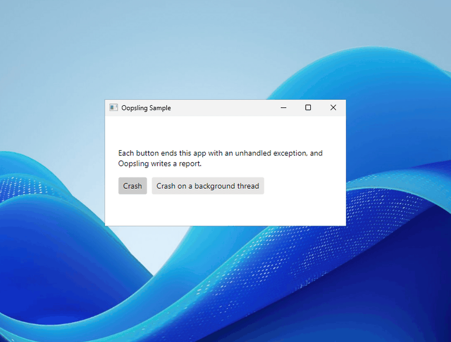
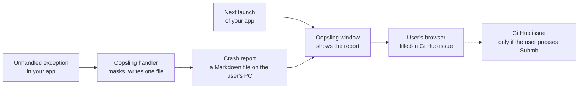

<h1 align="center">
  <picture>
    <source media="(prefers-color-scheme: dark)" srcset="docs/brand/lockup-dark.svg">
    
  </picture>
</h1>

<p align="center">
  <a href="https://github.com/hazeliscoding/oopsling/actions/workflows/ci.yml"></a>
  <a href="https://www.nuget.org/packages/Oopsling"></a>
  <a href="https://www.nuget.org/packages/Oopsling.Avalonia"></a>
</p>

**Oopsling turns a crash in your .NET app into a GitHub issue the user files themselves, and sends nothing on its own.**

If your app promises no telemetry, you can't tell when it crashes on someone else's PC. The crash reporters that exist send their reports to a server or by email, which breaks that promise. And a user whose app just vanished has nothing to paste into an issue.

## Before and after

**Before.** The app vanishes. The user doesn't know why, and you never hear about it.

**After.** At the next launch, the app says it closed because of an error and shows exactly what it would report. One button opens a filled-in GitHub issue in the user's own browser. They read it, edit it if they like, and press Submit, or don't.



A made-up report, as Oopsling writes it. The first line becomes the issue's title:

````markdown
Oopsling Sample 0.1.0 crashed: FileNotFoundException

```text
System.IO.FileNotFoundException: Could not find file '<home>/.config/oopsling-sample/settings.json'.
   at Oopsling.Sample.Settings.Load() + 0x8c
   at Oopsling.Sample.App.OnFrameworkInitializationCompleted() + 0x2b
```

- App: Oopsling Sample 0.1.0+4f2c1ab
- OS: Ubuntu 24.04.3 LTS
- Runtime: .NET 10.0.0
- Architecture: X64
- NativeAOT: yes
````

## What it does

- When an unhandled exception ends your app, Oopsling writes one report to a file on the user's PC: the exception and its stack, your app's version, and the OS, .NET version and architecture. Nothing else.
- Before it writes, it masks the home folder, the user name wherever it appears, and anything that looks like a token.
- At the next launch, a small Avalonia window shows the report, with Report on GitHub, Copy and Dismiss.
- Report on GitHub opens your repo's new-issue page with the title and report filled in. When a report is too long for a link, the link carries the top of the stack, and the whole report goes on the clipboard to paste in.
- For users without a GitHub account, you can give a contact, an email address or a link. The window shows it under its buttons, and clicking it copies the report and opens a mail draft or the page.
- The window speaks your app's language when you give it the text. It's English otherwise.
- It works on Windows, macOS and Linux, with NativeAOT, and costs one handler and one folder check at startup.

**The promise:** Oopsling never sends anything. A report leaves the PC only when the user reads it in their own browser and presses Submit, or sends it to your contact themselves.



There are two packages. `Oopsling` has no UI and works in any .NET app. `Oopsling.Avalonia` adds the window.

## Install

```sh
dotnet add package Oopsling.Avalonia
```

It brings in `Oopsling`, the core, with it.

## Quick start

In `Program.cs`, start Oopsling first thing in `Main`, with your app's name as users see it and the GitHub repo that reports are filed in:

```csharp
using Oopsling;

[STAThread]
public static void Main(string[] args)
{
    CrashReports.Start("My App", "owner/my-app");
    BuildAvaloniaApp().StartWithClassicDesktopLifetime(args);
}
```

In `App.axaml.cs`, show the last crash's report over your main window:

```csharp
using Oopsling.Avalonia;

// In OnFrameworkInitializationCompleted:
desktop.MainWindow = new MainWindow();
CrashReportWindow.ShowUnshown(desktop.MainWindow);
```

That's all. The report is read once the main window is open, so a launch costs only the handler and a check for the folder.

- **A tray app** with no main window calls `CrashReportWindow.ShowUnshown()` with no owner, and has to keep running when its last window closes, with `ShutdownMode.OnExplicitShutdown`.
- **Without Avalonia,** add `Oopsling` instead. At the next launch, `CrashReports.TakeUnshown()` returns the report the user hasn't seen, if there is one, with its `Text` to show and `OpenIssue()` to open the filled-in issue.
- **Reports** are Markdown files in a `crashes` folder under the app's name in local app data: `%LOCALAPPDATA%` on Windows, `~/Library/Application Support` on macOS and `~/.local/share` on Linux. The newest 10 are kept.
- **Issue templates:** if your repo has them, keep blank issues enabled. The link opens a blank issue with the report filled in, and with blank issues off, GitHub may show users the template picker instead.

### A contact, and your app's language

Since 1.1, `Start` also takes a contact for users without a GitHub account, an email address or an `https://` link, and the window's text. Write each string as a whole sentence with your app's name in it, since Oopsling fills nothing in. Each string you leave out stays English:

```csharp
CrashReports.Start("My App", "owner/my-app",
    contact: "crashes@my-app.example",
    strings: new CrashReportStrings
    {
        Closed = "My App wurde wegen eines Fehlers beendet.",
        ReportOnGitHub = "Auf GitHub melden",
        Copy = "Kopieren",
        Dismiss = "Schließen",
        Contact = "Kein GitHub-Konto? Schick den Bericht an",
    });
```

The contact goes after the `Contact` sentence, as a link. An email address opens a draft with the report's title as its subject, and the report goes on the clipboard to paste in. [The sample](samples/Oopsling.Sample/Program.cs) has every string in German.

## Status

**1.0.** It's on NuGet as [`Oopsling`](https://www.nuget.org/packages/Oopsling) and [`Oopsling.Avalonia`](https://www.nuget.org/packages/Oopsling.Avalonia), and its API follows semantic versioning from here. It works on Windows, macOS and Linux, NativeAOT or not. [Staypaw](https://github.com/hazeliscoding/staypaw)'s next release, v1.2, is the first app to ship with it. [ROADMAP.md](ROADMAP.md) has the decisions and milestones.

## Alternatives

Checked against their own repos, docs and NuGet pages on 2026-10-27.

| | Oopsling | [CrashReporter.NET](https://github.com/ravibpatel/CrashReporter.NET) | [Akeng.MauiCrashReporter](https://www.nuget.org/packages/Akeng.MauiCrashReporter) | [MaksIT.Core.UI](https://www.nuget.org/packages/MaksIT.Core.UI) | [Sentry for .NET](https://github.com/getsentry/sentry-dotnet) |
|---|---|---|---|---|---|
| UI | Avalonia window; the core has none | WinForms and WPF, Windows | .NET MAUI | Avalonia | None for crashes; guides for WPF, WinForms and MAUI, none for Avalonia |
| Report goes to | A file, then a GitHub issue the user files | Email, through the DrDump service or your SMTP server | Stays local; copy or the share sheet | Stays local; copy | sentry.io or your own Sentry server |
| User sees it first | Yes, in the window and on GitHub | Yes, unless set to silent | Yes | Yes | No; your code can edit or drop events in `SetBeforeSend` |
| Also does | Nothing else | Screenshots | Breadcrumbs, lifecycle tracking | About, What's New, log and screenshot windows | Grouping, alerts, release health, performance |
| Latest release | 1.0.0, 2026-10-27 | 1.6.0, 2021-01-02 | 1.0.9, 2026-08-31 | 0.1.0, 2026-10-10 | 6.12.1, 2026-10-13 |

**When to use something else:**

- If sending reports is fine for your app, use Sentry: it groups crashes from every user, alerts you and tracks release health, none of which Oopsling will do. [BugSplat](https://docs.bugsplat.com/) adds minidumps and symbols.
- On WinForms or WPF, for users without a GitHub account, CrashReporter.NET emails you the report. Its last release is from 2021; [d3sync's fork](https://github.com/d3sync/CrashReporter.NET) targets .NET 10.
- On .NET MAUI, use Akeng.MauiCrashReporter.
- If a local error window with Copy is enough for your Avalonia app, MaksIT.Core.UI has one, along with About and log windows.

## Contributing

Issues are welcome, above all from people who ship apps without telemetry: what you'd need in a crash report, and what must never be in one. [CONTRIBUTING.md](CONTRIBUTING.md) says how to build and test it. If a crash report held something personal, don't open an issue: [SECURITY.md](SECURITY.md) says how to send it privately.

## License

Apache-2.0. See [LICENSE](LICENSE).
